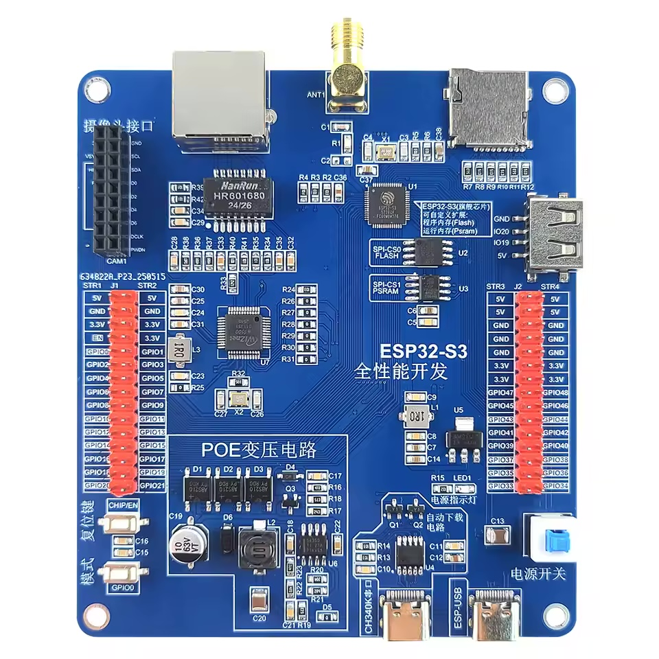
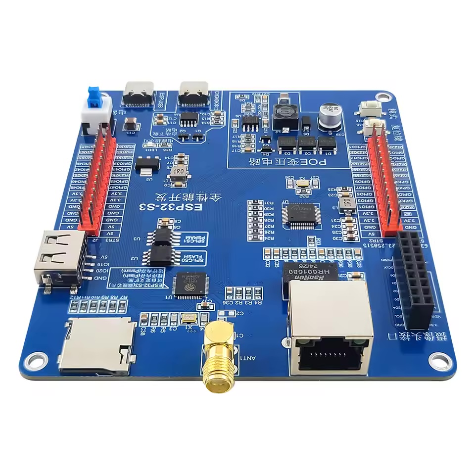
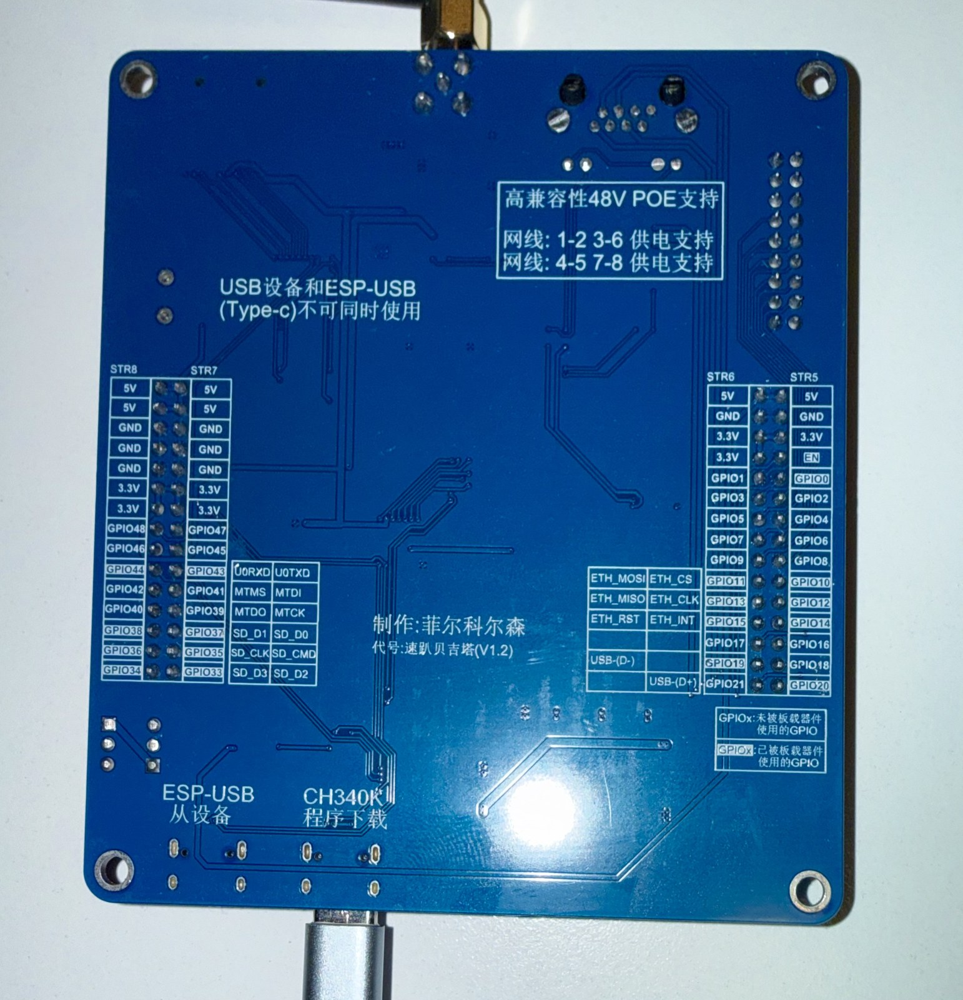

# ESP32-S3 PoE W5500 N16R8 development board

> [!WARNING]
> **Disclaimer: most of this repository was generated by AI.** The documentation and examples
> were written with an AI assistant (Claude). They are based on the schematic images from the
> AliExpress product listing and a few tests on one real board. Schematic readings can be wrong,
> and your board may differ from the schematics. Statements are marked **verified** only where
> they were checked on hardware. Check anything important (power, PoE, pin assignments) against
> your own board before relying on it. This project is not affiliated with the vendor.

Documentation and examples for a cheap ESP32-S3 development board from AliExpress. It has wired Ethernet (W5500), Power over Ethernet, 16 MB flash, 8 MB PSRAM, a microSD slot and an OV2640 camera
connector. The vendor provides almost no documentation beyond three schematic images.

<p align="center">
  
  
  
</p>

Layout, as seen in the top view above:

- **Top edge:** RJ45 (with PoE), SMA antenna connector, microSD slot
- **Left edge:** 18-pin camera connector (摄像头接口), header J1 (GPIO0–21), RESET button
  (复位键, `CHIP/EN`) and BOOT button (模式, `GPIO0`)
- **Right edge:** USB-A host port (`GND IO20 IO19 5V`), header J2 (GPIO33–48), power switch
  (电源开关)
- **Bottom edge:** USB-C **CH340K** serial port (CH340K串口, J3) and USB-C **ESP-USB** port (J4)
- **Lower left quarter:** PoE power supply (POE变压电路)

The bottom of the board (third photo) labels each header pin with its function. Its Chinese notes
translate as follows:

| Silkscreen | Translation |
|------------|-------------|
| 高兼容性48V POE支持 | High-compatibility 48 V PoE support |
| 网线: 1-2 3-6 供电支持 / 网线: 4-5 7-8 供电支持 | Power on cable pairs 1-2/3-6 supported / power on pairs 4-5/7-8 supported (PoE Mode A and Mode B) |
| USB设备和ESP-USB(Type-c)不可同时使用 | The USB-A device port and ESP-USB (Type-C) can't be used at the same time |
| ESP-USB 从设备 | ESP-USB, device mode |
| CH340K 程序下载 | CH340K, program download |
| GPIOx: 未被板载器件使用的GPIO | GPIOx (plain label): GPIO not used by on-board components |
| GPIOx: 已被板载器件使用的GPIO | GPIOx (highlighted label): GPIO used by on-board components |
| 代号: 速趴贝吉塔 (V1.2) | Code name "Super Vegeta", board revision **V1.2** |

## Board summary

| | |
|-|-|
| MCU | ESP32-S3 (QFN56) rev v0.2, dual-core 240 MHz, Wi-Fi + BLE 5, bare chip on the PCB |
| Flash | 16 MB W25Q128, quad SPI, 3.3 V |
| PSRAM | 8 MB ESP-PSRAM64H, **quad SPI (not octal)** |
| Ethernet | WIZnet W5500 on SPI2, 10/100 Mbit, RJ45 with LEDs |
| PoE | Mode A + Mode B, discrete front end (Class 0), TPS54360 buck converter, **not isolated** |
| USB | USB-C "ESP-USB" (native USB-Serial/JTAG), USB-C "CH340K" (UART0), USB-A (USB host) |
| Storage | microSD, 4-bit SDMMC |
| Camera | 18-pin OV2640 connector (DVP, no XCLK) |
| Controls | BOOT, RESET, latching power switch |
| Headers | 2× 30-pin (J1, J2) |
| Antenna | SMA connector, external 2.4 GHz antenna required |

## Read this first

1. **Use a USB-A to USB-C cable.** With a USB-C to USB-C cable the board gets no power and no
   serial port shows up. The USB-C connectors have no 5.1 kΩ CC resistors.
   [Details](docs/hardware.md#usb-c-to-usb-c-cables-dont-work).
2. **Press the big latching switch** in the bottom-right corner so it stays down. It is the power
   switch, and the blue LED1 turns on.
3. **Start with the ESP-USB port.** It needs no driver. The CH340K port needs the WCH driver on
   macOS, because the built-in driver doesn't support its USB ID `1a86:7522`
   ([details](docs/getting-started.md#the-ch340k-port-doesnt-show-up)).
4. **Set PSRAM to QSPI, not OPI.** This differs from most N16R8 modules.
5. **GPIO15 must be high for Ethernet to work.** The W5500 reset line has a pull-down.
6. **Ethernet may only be stable at 10 Mbit.** On at least one board the 100 Mbit link drops
   every few seconds, so the examples force 10 Mbit half duplex
   ([details](docs/getting-started.md#ethernet-link-keeps-going-up-and-down)).
7. **Don't use PoE and USB at the same time** unless you know the risk. The PoE supply isn't
   isolated, and its 5 V output is connected to the USB VBUS pins.

## Pin summary

| Function | GPIO |
|----------|------|
| W5500 CS / MOSI / SCLK / MISO / INT / RST | 10 / 11 / 12 / 13 / 14 / 15 |
| microSD CLK / CMD / D0 / D1 / D2 / D3 | 36 / 35 / 37 / 38 / 33 / 34 |
| Camera D0–D7 | 1–8 |
| Camera PCLK / VSYNC / HREF / SDA / SCL / RST | 9 / 21 / 16 / 18 / 17 / 0 |
| Native USB D- / D+ | 19 / 20 |
| UART0 TX / RX (CH340K) | 43 / 44 |
| BOOT button | 0 |
| Free | 39, 40, 41, 42, 47, 48 (and 45, 46 with care) |
| Flash/PSRAM (do not use) | 26–32 |

The full pinout, header layout and copy-paste `#define`s are in [docs/pinout.md](docs/pinout.md).

## Examples

| Example | Description | Tested on hardware |
|---------|-------------|:------------------:|
| [chip_info](examples/chip_info) | Prints chip, flash and PSRAM info. Use it to check your board settings. | yes |
| [ethernet_dhcp](examples/ethernet_dhcp) | W5500 with DHCP, then an HTTP GET | yes |
| [ethernet_webserver](examples/ethernet_webserver) | Status page over Ethernet with mDNS | yes |
| [wifi_station](examples/wifi_station) | Wi-Fi scan (antenna check), then connects and does an HTTP GET | yes |
| [sd_card](examples/sd_card) | Mounts the microSD in 4-bit SDMMC mode, lists files, reads and writes | yes |
| [camera_ethernet_stream](examples/camera_ethernet_stream) | [OV2640](https://aliexpress.com/item/1005007015642403.html) MJPEG stream over Ethernet | no |
| [usb_keyboard](examples/usb_keyboard) | USB keyboard on the USB-A port, keys printed on the CH340K port. Needs other settings, [see here](docs/hardware.md#using-the-usb-a-port-as-usb-host). | yes |

All examples compile with Arduino-ESP32 3.3.x. Run [`scripts/build-examples.sh`](scripts/build-examples.sh)
to build them all.

## Documentation

- [docs/getting-started.md](docs/getting-started.md): toolchain setup and troubleshooting
- [docs/hardware.md](docs/hardware.md): sheet-by-sheet schematic analysis (power, USB, PoE,
  Ethernet, SD, camera)
- [docs/pinout.md](docs/pinout.md): GPIO map and header pinouts
- [schematics/](schematics/): the vendor schematics

## Quick start (Arduino IDE)

Add the [ESP32 by Espressif Systems](https://docs.espressif.com/projects/arduino-esp32/en/latest/installing.html) board URL and select the **ESP32S3 Dev Module** with these settings:

- USB CDC On Boot: **Enabled**
- Flash Size: **16MB**
- PSRAM: **QSPI PSRAM**
- Partition Scheme: 16M Flash (3MB APP/9.9MB FATFS)

Then upload [`examples/chip_info`](examples/chip_info). It should report 16 MB flash and about
8 MB PSRAM. [docs/getting-started.md](docs/getting-started.md) also covers arduino-cli,
PlatformIO and ESP-IDF.

## Setting up CLI tools on a new Mac

These steps install everything needed to flash the board and build the examples on a clean
macOS install (Apple silicon or Intel). The board's native USB port needs no driver.

1. **Install Homebrew**, the macOS package manager. This also installs the Xcode Command Line
   Tools, which include `git`:

   ```sh
   /bin/bash -c "$(curl -fsSL https://raw.githubusercontent.com/Homebrew/install/HEAD/install.sh)"
   ```

   When it finishes, run the two `eval` / `echo` commands it prints under *Next steps*. They add
   `brew` to your `PATH`. Then open a new terminal.

2. **Install the tools.** `esptool` flashes and identifies the chip, and `arduino-cli` builds
   the examples from the command line:

   ```sh
   brew install esptool arduino-cli
   ```

   Optional extras:

   ```sh
   brew install --cask arduino-ide   # graphical Arduino IDE 2
   brew install platformio           # if you prefer PlatformIO
   ```

   You only need the **CH340K port (J3)** if you want UART0. It needs WCH's driver, because the
   macOS built-in driver doesn't support its USB ID. Install
   [CH34XSER_MAC](https://www.wch-ic.com/downloads/CH34XSER_MAC_ZIP.html), open the
   `CH34xVCPDriver` app and click **Install**. Then **turn it on** under System Settings →
   General → Login Items & Extensions → Driver Extensions. It is installed switched off.

3. **Install the ESP32 Arduino core** (Espressif's board support package, version 3.x):

   ```sh
   arduino-cli config init
   arduino-cli config add board_manager.additional_urls \
     https://espressif.github.io/arduino-esp32/package_esp32_index.json
   arduino-cli core update-index
   arduino-cli core install esp32:esp32
   ```

   In the Arduino IDE, use **Settings → Additional boards manager URLs** to add the same URL, then
   install **esp32 by Espressif Systems** from the Boards Manager.

4. **Get this repository:**

   ```sh
   git clone <repository-url>
   cd esp32-s3-poe-w5500-n16r8-dev-board
   ```

5. **Connect the board.** Use a USB-A to USB-C cable to the **ESP-USB** port (on a Mac with only
   USB-C ports, use a USB-C to USB-A adapter), press the power switch, then check:

   ```sh
   ls /dev/cu.usbmodem*                       # e.g. /dev/cu.usbmodem21401
   esptool --port /dev/cu.usbmodem* chip-id   # should report ESP32-S3
   ```

   If macOS asks whether to allow the accessory to connect, choose **Allow**.

6. **Build, flash and watch the first example:**

   ```sh
   FQBN='esp32:esp32:esp32s3:CDCOnBoot=cdc,USBMode=hwcdc,FlashSize=16M,FlashMode=qio,PSRAM=enabled,PartitionScheme=app3M_fat9M_16MB'
   PORT=$(ls /dev/cu.usbmodem* | head -1)
   arduino-cli compile --fqbn "$FQBN" examples/chip_info
   arduino-cli upload  --fqbn "$FQBN" -p "$PORT" examples/chip_info
   arduino-cli monitor -p "$PORT" -c baudrate=115200   # quit with Ctrl-C
   ```

   `scripts/build-examples.sh` compiles every example, and also uploads them when you pass a
   port.

## Contributing

Corrections, photos of the board (front and back), test results with different PoE switches, and
new examples are welcome. Please open an issue or a pull request.

## License

The documentation and example code are released under the [MIT License](LICENSE). The schematic
images in [schematics/](schematics/) belong to the vendor and are included for reference only.
